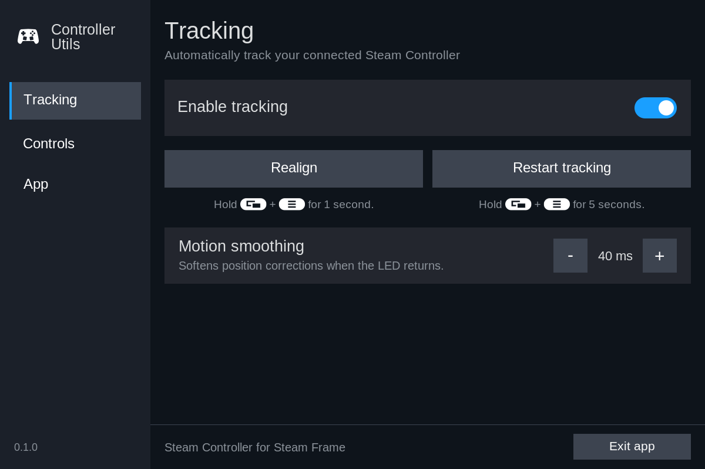

# Controller Utils

Adds support for tracking the 2026 Steam Controller on Steam Frame over Bluetooth.
It uses Frame's native tracking services to track position through the controller's
IR LED, and the controller's IMU for orientation.

The app displays a 3D controller model in VR. You can navigate Steam's UI with a
laser pointer or touchpad cursor, and type with both touchpads. Steam Controller
tracking also works while Frame's own controllers are being tracked.



Tracking relies on a single IR LED. It can become unstable or drift when the LED
is hidden from the headset's cameras. Position tracking recovers when you hold
the controller with the LED visible to the headset again.

Since the driver interfaces directly with Frame's native tracking services,
SteamOS and SteamVR updates can break tracking and require an app update. I'll try
to maintain this at least until Valve releases official tracking support for the
Steam Controller.

The app is experimental.

## Install

1. On Frame, put the ARM64 archive, `latest.json` and `latest.sig` from the same
   [release](https://github.com/kallupx/controller-utils/releases) in one folder.
2. Open a terminal there as `steamos`. Set a password with `passwd` if needed.
3. Download the verifier separately from this repository, then run it without sudo:

   ```sh
   curl --fail --proto '=https' --tlsv1.2 \
     https://raw.githubusercontent.com/kallupx/controller-utils/v0.1.0/packaging/bootstrap.py \
     --output controller-utils-bootstrap.py
   python3 controller-utils-bootstrap.py "$PWD"
   ```

   The verifier checks the signature before running the installer. Installation
   asks for administrator access and may restart SteamVR.
4. Start SteamVR and open Controller Utils from the desktop launcher. Pair your
   gamepad with Frame, leave Enable tracking on and follow the headset prompts.

The app starts with SteamVR after its first launch. Change this in App settings.
For an existing installation, use updates or uninstall before installing again.

If installation asks for cleanup, run
`python3 controller-utils-bootstrap.py --cleanup "$PWD"` from the same folder
before retrying.

## Controls

| Input | Action |
| --- | --- |
| R4 | Toggle UI control, configurable in Controls |
| Right pad | Move the cursor, release to return to the laser |
| Right trigger or right pad click | Click |
| Left trigger | Right-click |
| Right stick or left pad | Scroll |
| View + Menu, hold 1 second then release | Realign heading |
| View + Menu, hold 5 seconds | Restart tracking |
| Steam + X | Open the keyboard |
| Steam, hold 1 second then release | Recenter the view |
| Steam, double press | Toggle passthrough |

Enable Steam shortcuts in Controls for recenter and passthrough.

With UI control on, look at the keyboard and touch either pad to type. Both pads
control the typing cursors. Typing stays active while you look away. Release both
pads to aim again.

## Updates and removal

Enable Automatic updates in App settings to download signed GitHub releases.
For a manual check, select Check now. Updates install when SteamVR next starts. Later updates
and permission repairs run without another password prompt.

To uninstall, start SteamVR and run:

```sh
~/.local/share/controllertracking/app/uninstall.sh
```

Removal asks for administrator access. Updates and removal keep settings and
per-controller calibration in `~/.local/share/controllertracking/app-data`.

## Build

The [CI workflow](.github/workflows/checks.yml) lists the required compilers,
libraries and tools. With those installed:

```sh
python3 -m venv .venv
.venv/bin/pip install -r requirements-dev.txt
export PATH="$PWD/.venv/bin:$PATH"
make -j4 all
make check-format
make check
make -j4 check-sanitize
```

Desktop builds support automated tests. Headset binaries require ARM64 and
Frame-compatible system libraries.

## License

Code is [MIT licensed](LICENSE). The bundled Valve controller model is
CC BY-NC-SA 4.0, so the complete bundle has noncommercial artwork restrictions.
Textures are CC BY 4.0 and the Kenney icon is CC0. See [artwork credits](assets/README.md)
and the [OpenVR license](third_party/openvr/LICENSE).

This project is not affiliated with Valve.
